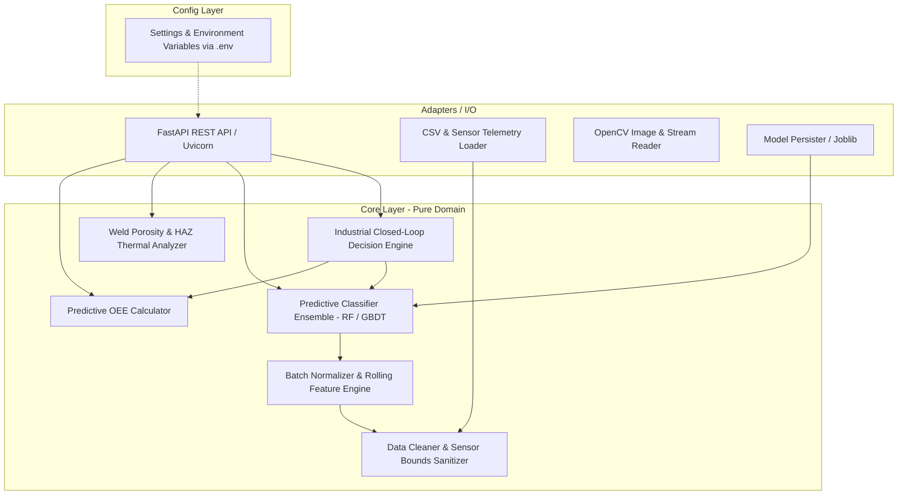

# Arquitetura do Sistema - VulcanTech Smart Metals S.A.
**Norma de Referência:** ISO/IEC/IEEE 42010  
**Padrão Arquitetural:** Clean Architecture / Hexagonal Ports & Adapters  
**Versão:** 1.0.0  

---

## 1. Visão Geral do Sistema

O sistema é uma plataforma embarcada/Edge de **Monitoramento Preditivo em Malha Fechada**, integrando telemetria IoT de usinagem e estampagem com visão computacional para garantia de qualidade e mitigação de falhas industriais.

---

## 2. Divisão de Módulos e Responsabilidades

| Módulo | Caminho | Responsabilidade | Requisitos Rastreados |
|---|---|---|---|
| **Data Cleaner** | `src/core/limpeza_dados.py` | Saneamento físico (remoção de ruídos `-99.0`, `999.9`, `-1.0`), Z-score condicional por liga e interpolação temporal por célula. | RF-001, RF-002, RF-003 |
| **Feature Engineering** | `src/core/engenharia_features.py` | Janelas móveis (30m, 2h), cálculo de `IEM` e normalização das variáveis pela média histórica da liga metálica. | RF-004, RF-005, RF-006 |
| **Predictive Model** | `src/core/modelo_preditivo.py` | Treinamento, balanceamento de classes (`class_weight='balanced'`), inferência multiclasse e avaliação de Recall por classe. | RF-007, RF-008, RF-009, RF-011 |
| **Decision Engine** | `src/core/motor_decisao.py` | Lógica de malha fechada: converte inferência probabilística em ordens de controle (`MANTER_OPERACAO`, `REDUZIR_VELOCIDADE_50%`, `INTERROMPER_EMERGENCIA`). | RF-014, RF-015 |
| **OEE Calculator** | `src/core/calculadora_oee.py` | Avaliação de impacto preditivo nos três pilares do OEE (Disponibilidade, Performance e Qualidade). | RF-010 |
| **Vision Processor** | `src/core/visao_computacional.py` | Algoritmos de Visão Computacional: nitidez, Canny e contornos para porosidade de cordão; segmentação HSV para pontos quentes HAZ. | RF-012, RF-013 |
| **REST Adapters** | `src/adapters/api/` | Endpoints FastAPI (`/health`, `/predict`, `/predict-batch`, `/vision/*`) com validação Pydantic. | RF-014, RF-015, RF-016 |
| **Settings** | `src/config/configuracoes.py` | Leitura centralizada de variáveis de ambiente com defaults seguros (12-factor app). | RNF-004, RNF-005 |
| **Main Entrypoint** | `src/main.py` | Inicialização do servidor Uvicorn / pipeline industrial em ponto único de entrada. | RNF-001, RNF-002 |

---

## 3. Estimativa e Declaração de Consumo de Recursos

- **RAM em Execução (Idle):** ~65 MB a 90 MB (FastAPI + Scikit-Learn modelo serializado em memória).
- **RAM sob Carga (Inferência em lote):** ~120 MB a 140 MB (dentro da meta < 150 MB de RNF-001).
- **Latência de Inferência Unitária:** < 8 ms por requisição em processadores de borda modestos.
- **Armazenamento em Disco:**
  - Código-fonte e dependências: ~35 MB (excluindo cache Python).
  - Modelo serializado (`.joblib`): ~1.5 MB a 4 MB.

---

## 4. Rastreamento e Decisões de Arquitetura

As decisões técnicas fundamentais estão formalizadas nos seguintes ADRs em `docs/architecture/adr/`:
- `0001-escolha-stack-ml-e-algoritmo.md`: Uso de Scikit-Learn Random Forest e GBDT para eficiência máxima sem dependências pesadas C++.
- `0002-arquitetura-hexagonal-limpa.md`: Separação estrita de `src/core/` sem frameworks externos.
- `0003-visao-computacional-hsv-canny.md`: Pipeline determinístico em OpenCV para inspeção em tempo real.
